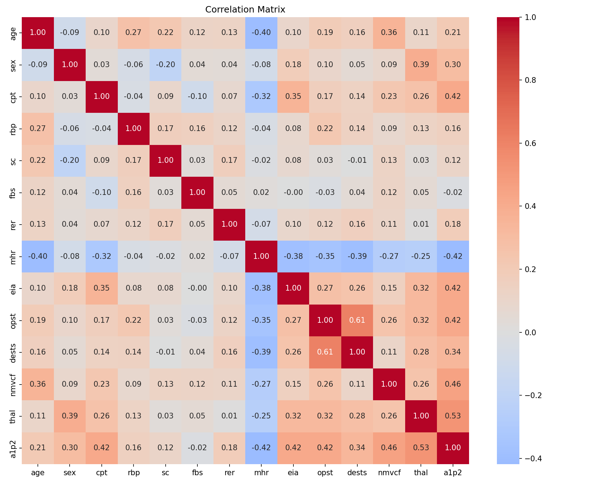
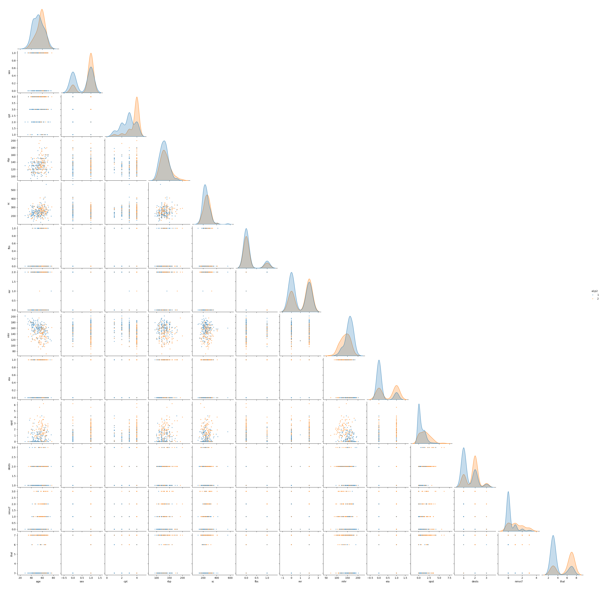

# Heart Disease Prediction

Predicting the presence of heart disease from 13 patient measurements, as a
scenario for a fictional company (AMAPE). The project has two parts:

1. **Exploratory analysis** of the data: correlations, covariance matrix, pair plot.
2. **Model comparison** of six classifiers, each tuned to its best parameters.

All 13 features are used in every model (no feature elimination, no PCA).

## Dataset

`data/heart1.csv`: 270 patients, 13 features and a target column `a1p2`
(1 = absence of heart disease, 2 = presence). 150 patients are healthy and
120 have heart disease. There are no missing values or duplicate rows.

| Column | Description |
|---|---|
| age, sex | age and sex |
| cpt | chest pain type (4 values) |
| rbp | resting blood pressure |
| sc | serum cholesterol (mg/dl) |
| fbs | fasting blood sugar > 120 mg/dl |
| rer | resting electrocardiographic results (0, 1, 2) |
| mhr | maximum heart rate achieved |
| eia | exercise-induced angina |
| opst | ST depression induced by exercise relative to rest |
| dests | slope of the peak exercise ST segment |
| nmvcf | number of major vessels (0-3) colored by fluoroscopy |
| thal | 3 = normal, 6 = fixed defect, 7 = reversible defect |
| a1p2 | **target**: 1 = absence, 2 = presence |

## Quick start

```bash
pip install -r requirements.txt
python heart_project.py            # analysis, models, confusion counts
python heart_project.py --extras   # also repeated cross-validation
```

Figures and tables are written to `results/`. Options: `--data` (CSV path),
`--out` (output folder).

## Findings: data analysis

- Features most correlated with heart disease: `thal` (0.53), `nmvcf` (0.46),
  `eia`, `opst` and `cpt` (about 0.42 each), and `mhr` (-0.42, negative).
- `fbs` has essentially no correlation with the outcome (-0.02).
- The strongest correlation between two features is `opst` with `dests` (0.61).





Other outputs: [covariance heatmap](results/covariance_heatmap.png) and
[covariance matrix](results/covariance_matrix.csv).

## Findings: model comparison

70/30 stratified train/test split (`random_state=1`), features standardized
with a scaler fit on the training set only. Hyperparameters were chosen by 5-fold
cross-validation on the training set; only the final values appear in the code.

| Method | Parameters | Train % | Test % |
|---|---|---|---|
| Perceptron | eta0=0.1, max_iter=10, L2 | 85.7 | 77.8 |
| Logistic Regression | C=0.03 | 87.3 | 80.2 |
| **SVM (linear)** | C=0.01 | 86.2 | **81.5** |
| Decision Tree | entropy, max_depth=4 | 92.6 | 67.9 |
| Random Forest | 100 trees | 100.0 | 79.0 |
| K-Nearest Neighbor | K=30 | 86.8 | 79.0 |

Confusion counts on the test set (positive = heart disease; 45 healthy and
36 diseased patients):

| Method | TN | FP | FN | TP | Sensitivity % | Specificity % | Precision % |
|---|---|---|---|---|---|---|---|
| Perceptron | 36 | 9 | 9 | 27 | 75.0 | 80.0 | 75.0 |
| Logistic Regression | 38 | 7 | 9 | 27 | 75.0 | 84.4 | 79.4 |
| SVM (linear) | 39 | 6 | 9 | 27 | 75.0 | 86.7 | 81.8 |
| Decision Tree | 33 | 12 | 14 | 22 | 61.1 | 73.3 | 64.7 |
| Random Forest | 39 | 6 | 11 | 25 | 69.4 | 86.7 | 80.6 |
| K-Nearest Neighbor | 41 | 4 | 13 | 23 | 63.9 | 91.1 | 85.2 |

Notes:

- A missed diagnosis (FN) is usually costlier than a false alarm (FP). The
  Perceptron, Logistic Regression and linear SVM each miss 9 patients.
- The Random Forest's 100% is training accuracy (memorization). Its test accuracy
  is 79.0%. A shuffled-label check confirmed there is no data leakage.
- The test set holds only 81 patients (one patient is about 1.2 points), so small
  gaps between models are noise. Repeated 5-fold cross-validation (`--extras`)
  gives the same ranking: linear SVM 84.9%, Logistic Regression 84.4%,
  KNN 84.4%, Random Forest 82.0%, Perceptron 78.3%, Decision Tree 76.7%.
- Confidence of each prediction is available from `predict_proba` for every model
  except the Perceptron.

## Project structure

```
heart-disease-prediction/
├── heart_project.py     # analysis + models (single file)
├── data/heart1.csv
├── results/             # figures, tables, console output
├── requirements.txt
└── README.md
```
